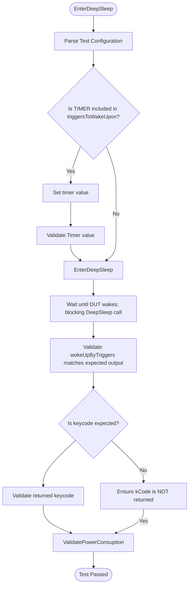

# DEEPSLEEP L3 Low Level Test Specification

## Table of Contents

- [Overview](#overview)
- [Acronyms, Terms and Abbreviations](#acronyms-terms-and-abbreviations)
- [References](#references)
- [Level 3 Test Specification](#level-3-test-specification)
    - [DUT Side Implementation](#dut-side-implementation)
    - [HOST Side Implementation](#host-side-implementation)

## Overview

This document defines the Level 3 (L3) Low-Level Test Specification for validating the deepsleep and wakeup functionality in a device under test (`DUT`).
The objective of `L3` testing is to validate deepsleep wakeup from various triggers and its powe consumption during deepsleep through automated test execution using `VTS` and `RAFT` frameworks.

The goal is to ensure that:
- The DUT correctly enters `DeepSleep`.
- The DUT wakes up only from expected wake-up triggers.
- Lower Power consumption in `DeepSleep` mode.

### Acronyms, Terms and Abbreviations

- `HAL`    - Hardware Abstraction Layer
- `VTS`    - Vendor Test Suite
- `L1`     - Level 1 Testing
- `L2`     - Level 2 Testing
- `L3`     - Level 3 Testing
- `DUT`    - Device Under Test
- `RAFT`   - Rapid Automation Framework for Testing
- `YAML`   - YAML Ain't Markup Language
- `AIDL`   - Android Interface Definition Language

### References

- `High Level Test Specification` - [deepsleep_High-Level_TestSpecification.md](deepsleep_High-Level_TestSpecification.md)
- [DEEPSLEEP AIDL interface](https://github.com/rdkcentral/rdk-halif-aidl/tree/0.12.0/deepsleep/current/com/rdk/hal/deepsleep)

## Level 3 Test Specification

### `DUT` Side Implementation

The `VTS` binary running on the DUT provides a key L3 capabilities:

- EnterDeepSleep - Enter `DeepSleep` and validate `HAL` behaviour for wakeup from different triggers.


#### EnterDeepSleep

##### Objective

The purpose of the `EnterDeepSleep` Level 3 test is to verify that the `DUT` correctly enters the DeepSleep low-power state and wakes up according to the triggers specified in the test configuration. Specifically, the test ensures that:

- The `DUT` enters DeepSleep and wakes up only when a valid trigger occurs.
- The `HAL` reports wake-up from valid triggers.
- Power consumption during `DeepSleep` is within limits defined in the test configuration.

##### Flow



##### Configuration File (YAML)

`EnterDeepSleep` uses the following configuration structure:

```yaml
DeepSleep:
  L3:
    EnterDeepSleep:
      Parameters:
        timer: 10
        input_triggersToWakeUpon: [RCU_IR, RCU_BT, TIMER, FRONT_PANEL, CEC, PRESENCE, VOICE]
      Expected_Results:
        expectedwaittime: 5
        output_wokeUpByTriggers: [RCU_IR]
        output_keycode: 6
```

- **timer:** Timer value (in seconds) to be set for `TIMER` trigger
- **input_triggersToWakeUpon:** List of possible wakeup triggers on which `HAL` must wakeup-on.
- **expectedwaittime:** Expected time in seconds the `DUT` is expected to remain in DeepSleep before waking.
- **output_wokeUpByTriggers:** List of expected wake sources reported by the `HAL`x.
- **output_keycode:** Expected key code value (applicable for RCU-related triggers).

### Host Side Implementation

`RAFT` automates orchestrating DeepSleep trigger injection, monitoring, and verification on `DUT`.

#### WakeFromSupportedTrigger Test

**Purpose:**
Verify that the `DUT` wakes up exactly from the expected trigger, and not from any other trigger.

**Test Flow:**

- Deploy `VTS` binaries to `DUT`.
- Configure the `Deepsleep` wakeup controller.
- Put `DUT` into DeepSleep by starting `VTS` binary
- Apply wake trigger from RAFT
- Verify `DUT` wake up
- Validate the following scenarios:
  - Positive cases:
    - The wokeUpByTriggers should match the trigger that `DUT` woke upon
    - Keycode should match the expected value
    - Wakeuptime should be less or equal to expected wait time
  - Negative cases: No HAL callbacks when:
    - The wokeUpByTriggers doesnt match the trigger that `DUT` woke upon
    - Keycode did not match the expected value
    - Wakeuptime should is greater than expected wait time

#### WakeFromPreconfiguredTrigger Test

**Purpose:**
Verify that the `DUT` wakes on preconfigured triggers, even without specifying input triggers.

**Test Flow:**

- Deploy `VTS` binaries to `DUT`.
- Configure the `Deepsleep` wakeup controller.
- Put `DUT` into DeepSleep by starting `VTS` binary with no explicit triggers
- Apply wake trigger from RAFT using preconfigured trigger
- Verify `DUT` wake up
- Validate the following scenarios:
  - Positive cases:
    - The wokeUpByTriggers should match the trigger that `DUT` woke upon
    - Keycode should match the expected value
    - Wakeuptime should be less or equal to expected wait time
  - Negative cases: No HAL callbacks when:
    - The wokeUpByTriggers doesnt match the trigger that `DUT` woke upon
    - Keycode did not match the expected value
    - Wakeuptime should is greater than expected wait time

#### VerifyWakeWithMixedInputTriggerList Test

**Purpose:**
Verify that the `DUT` wakes up exactly from the any oe of the input trigger specified.

**Test Flow:**

- Deploy `VTS` binaries to `DUT`.
- Configure the `Deepsleep` wakeup controller.
- Put `DUT` into DeepSleep by starting `VTS` binary with mltiple trigger in input list
- Apply wake trigger from RAFT 
- Verify `DUT` wake up
- Validate the following scenarios:
  - Positive cases:
    - The wokeUpByTriggers should match the trigger that `DUT` woke upon
    - Keycode should match the expected value
    - Wakeuptime should be less or equal to expected wait time
  - Negative cases: No HAL callbacks when:
    - The wokeUpByTriggers doesnt match the trigger that `DUT` woke upon
    - Keycode did not match the expected value
    - Wakeuptime should is greater than expected wait time

#### NoWakeFromUnspecifiedOrUnsupportedTrigger Test

**Purpose:**
Verify that the `DUT` doest'nt wakeup on below scenarios.
1. No deepsleep wake up from triggers not specified in supported trigger list.
2. No deepsleep wake up from triggers not specified in input trigger list.

**Test Flow:**

- Deploy `VTS` binaries to `DUT`.
- Configure the `Deepsleep` wakeup controller.
- Put `DUT` into DeepSleep by starting `VTS` binary
- Apply wake trigger from RAFT using unsupported trigger

- Verify no `DUT` wake up
